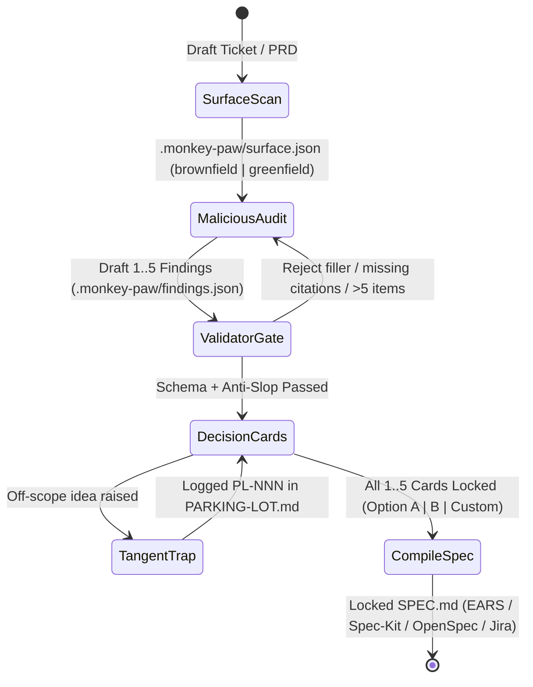

# `monkey-paw`

**A coding agent is a literal-minded genie: give it an underspecified ticket, and it will pass every happy-path test while quietly corrupting production.**  
**`monkey-paw` runs a deterministic, read-only <10-minute malicious compliance audit before a single line of app code is written.**

[](./LICENSE)
[](./scripts/)
[](./SKILL.md)

---

## Why This Exists

Most AI coding failures are not syntax bugs—they are **specification loopholes**. Ask an agent to *"add a Refund button via Stripe"*, and it will wire up the endpoint in ninety seconds without row locks (`concurrency_race`), tenant ownership predicates (`auth_boundary_leak`), split-brain recovery if Postgres drops after Stripe succeeds (`partial_mutation`), or entitlement revocation (`orphaned_state`).

`monkey-paw` pairs **The Monkey's Paw** (an adversarial pass grounded in your actual codebase surface) with a **Staff TPM Referee** that deals bounded **Bilingual Decision Cards**—concrete Option A vs. Option B engineering mechanics alongside plain-language PM UX/latency/scope trade-offs—traps scope creep into `PARKING-LOT.md`, and compiles locked choices into **EARS**, **GitHub Spec-Kit (`spec.md`)**, **OpenSpec**, or **Jira** checklists.

---

## Install (`npx skills add`) — Zero Lock-In

Install once into any workspace using the open [`skills`](https://agentskills.io) CLI:

```bash
npx skills add orphik/monkey-paw
```

Because `monkey-paw` ships a strict `agentskills.io` root [`SKILL.md`](./SKILL.md), [`AGENTS.md`](./AGENTS.md), zero-dependency Python 3.10+ `stdlib` scripts, and a built-in JSON-RPC 2.0 `stdio` MCP server, it works identically across every major coding agent:

| Agent / Runtime | Install Command or Wiring | Natural-Language Trigger Example |
| :--- | :--- | :--- |
| **Antigravity** | `npx skills add orphik/monkey-paw -a antigravity` | *"Stress-test `ticket.md` for loopholes before we write code."* |
| **Claude Code** | `npx skills add orphik/monkey-paw -a claude-code` | *"Run a pre-code malicious compliance check on this PRD."* |
| **Cursor** | `npx skills add orphik/monkey-paw -a cursor` | *"Find the top ways an agent could break prod from this spec."* |
| **Codex** | `npx skills add orphik/monkey-paw -a codex` | *"Pre-flight `draft-spec.md` against this repo and lock EARS clauses."* |
| **GitHub Copilot** | `npx skills add orphik/monkey-paw -a github-copilot` | *"Review this ticket for concurrency, auth, and partial-mutation gaps."* |
| **Windsurf** | `npx skills add orphik/monkey-paw -a windsurf` | *"Referee this feature spec and give me A/B decision cards."* |
| **Kiro** | `npx skills add orphik/monkey-paw -a kiro` | *"Audit our draft requirements and export a locked EARS `SPEC.md`."* |
| **Gemini CLI** | `npx skills add orphik/monkey-paw -a gemini-cli` | *"Stress-test this spec read-only and park Phase-2 tangents."* |

### Optional: Native MCP `stdio` Server

Any MCP-capable client can also mount [`scripts/mcp_stdio_server.py`](./scripts/mcp_stdio_server.py) directly with zero `pip` or `npm` dependencies:

```json
{
  "mcpServers": {
    "monkey-paw": {
      "command": "python3",
      "args": ["/absolute/path/to/monkey-paw/scripts/mcp_stdio_server.py"]
    }
  }
}
```

---

## Referee State Loop



---

## Before & After: EARS Demo

### Before (Raw Slack / Linear Ticket)
> *"Add `POST /v1/charges/{charge_id}/refund` so dashboard users and support can issue full or partial refunds via Stripe and mark the order `REFUNDED`. Don't refund more than the original charge."*

### What a Literal Coding Agent Actually Builds (The Monkey's Paw)
1. **`concurrency_race`:** Checks `if charge.refunded_cents + req.amount <= charge.amount:` in Python memory; two simultaneous clicks pass at `t=0ms` and refund **200%** via Stripe.
2. **`partial_mutation`:** Calls `stripe.Refund.create()` before `db.commit()`; a `$5` partial refund marks a `$500` order `REFUNDED`, and a DB timeout after Stripe succeeds leaves the ledger showing `PAID`.
3. **`auth_boundary_leak`:** Uses `Depends(get_current_user)` without filtering `merchant_id == actor.merchant_id` (cross-tenant IDOR) or capping tier-1 support refunds.

### After (`SPEC.md` Locked via `compile_locked_spec.py --format ears`)
```markdown
- **Requirement [MP-001]:** WHEN `POST /v1/charges/{charge_id}/refund` is invoked, THE SYSTEM SHALL acquire a `SELECT ... FOR UPDATE NOWAIT` lock on `charges` before evaluating `refunded_cents + refund_amount_cents <= amount_cents`.
- **Requirement [MP-001]:** IF a concurrent transaction holds the row lock on `charges` or `refunded_cents + refund_amount_cents > amount_cents`, THEN THE SYSTEM SHALL abort before calling Stripe and return HTTP 409 Conflict or HTTP 422 Unprocessable Entity respectively.
- **Requirement [MP-002]:** WHEN `refunded_cents` is greater than `0` and less than `amount_cents`, THE SYSTEM SHALL set `Order.status` to `PARTIALLY_REFUNDED`, transitioning `Order.status` to `REFUNDED` only when `refunded_cents == amount_cents`.
- **Requirement [MP-003]:** WHEN a merchant-scoped caller invokes `POST /v1/charges/{charge_id}/refund`, THE SYSTEM SHALL filter the target charge by `id = charge_id AND merchant_id = caller.merchant_id` and require role `MERCHANT_OWNER` or `MERCHANT_FINANCE`, returning HTTP 404 on tenant mismatch and HTTP 403 on insufficient role.
```

See the complete fixture in [`assets/examples/sample-fintech-refund/`](./assets/examples/sample-fintech-refund/).

---

## Six Production Loophole Classes

`scripts/validate_findings.py` restricts findings to `1..5` high-severity vulnerabilities across six enum classes and automatically rejects generic filler (*"add proper error handling"*, *"follow best practices"*):

| `exploit_class` | Failure Mode Caught Before Code |
| :--- | :--- |
| `orphaned_state` | Parent deactivated/refunded while cron jobs, API keys, escrow holds, or cached entitlements stay active. |
| `partial_mutation` | Sequential writes across DB + Stripe/S3/email without idempotency keys or outbox recovery leave split-brain state. |
| `auth_boundary_leak` | Endpoint checks authentication (`is_logged_in`) without tenant scoping (IDOR), RLS, or role ceilings. |
| `concurrency_race` | Check-then-act reads without `FOR UPDATE`, version CAS, or unique constraints fail on double-clicks and retries. |
| `blast_radius_scale` | Synchronous `O(N)` loops, unbounded `SELECT *`, or unthrottled downstream bursts time out gateways. |
| `silent_fallback` | Catch-all fallbacks (`or 0`, HTTP `200` on failure) hide billing declines, timeouts, or dropped webhooks. |

---

## Interactive Browser Simulator (Zero API Key)

Open [`docs/index.html`](./docs/index.html) locally or host via GitHub Pages (`docs/` folder) to test-drive the referee loop with zero setup:
- **3 Broken Real-World Tickets:** *SaaS Billing Pause*, *Blind Bid Withdrawal*, and *Webhook Payout Retry*.
- **Clickable Bilingual Decision Cards:** Compare Option A vs. Option B engineering designs alongside plain-English PM UX/latency/scope pills.
- **Live Tangent Trap:** Route realistic teammate scope-creep comments straight into `PARKING-LOT.md`.
- **Real-Time Compiler:** Watch `SPEC.md` recompile live across **EARS**, **Spec-Kit**, **OpenSpec**, and **Jira** formats.

---

## CLI Toolkit Reference

All scripts require **Python 3.10+ standard library only** (`zero pip install`):

```bash
# 1. Scan brownfield repo surface (or degrade cleanly to greenfield on empty dirs)
python3 scripts/extract_repo_surface.py --repo /path/to/app --out .monkey-paw/surface.json

# 2. Validate 1..5 candidate or resolved findings (enforces citations + rejects filler)
python3 scripts/validate_findings.py --findings .monkey-paw/findings.json --surface .monkey-paw/surface.json

# 3. Park off-scope tech debt / Phase-2 ideas during refinement
python3 scripts/park_tangent.py --item "Migrate legacy Stripe Charges to PaymentIntents" --category tech-debt --out PARKING-LOT.md

# 4. Compile locked choices into EARS, Spec-Kit, OpenSpec, or Jira markdown
python3 scripts/compile_locked_spec.py --draft draft.md --findings .monkey-paw/findings.json --format ears --out SPEC.md
```

---

## Security & Read-Only Guarantees

- **Zero App Mutation:** Never edits application code; temp state stays in `.monkey-paw/` (gitignored).
- **Secret Shield:** `extract_repo_surface.py` blocks `.env*`, `*.pem`, `*.key`, `*.p12`, `id_rsa*`, `*credentials*.json`, `.npmrc`, `.pypirc`, and `.netrc` *before* opening files, skips binaries and files `>512 KB`, respects `.gitignore`, and scrubs inline token patterns (`sk-...`, `AKIA...`, `ghp_...`, PEM blocks, credentialed DB URLs).
- **Bounded Context:** Output JSON obeys `--max-bytes` (default `64 KB`) so large monorepos never blow up agent token budgets.

---

## Local Dogfooding & Tests

Run the test suite across all modules:

```bash
python3 -m unittest discover -s tests -v
```

Dogfood against another local repository in two commands:

```bash
python3 /path/to/monkey-paw/scripts/extract_repo_surface.py --repo /path/to/target-repo --out /path/to/target-repo/.monkey-paw/surface.json
npx skills add /path/to/monkey-paw
```

---

## License

[MIT](./LICENSE)
